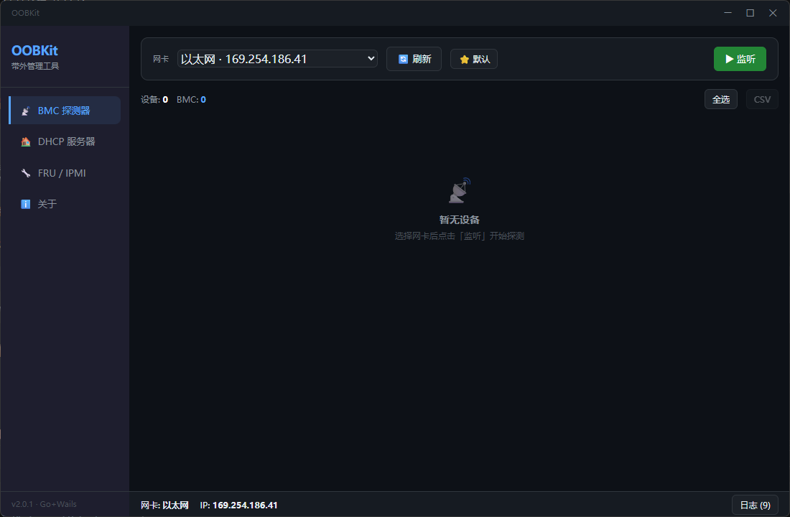
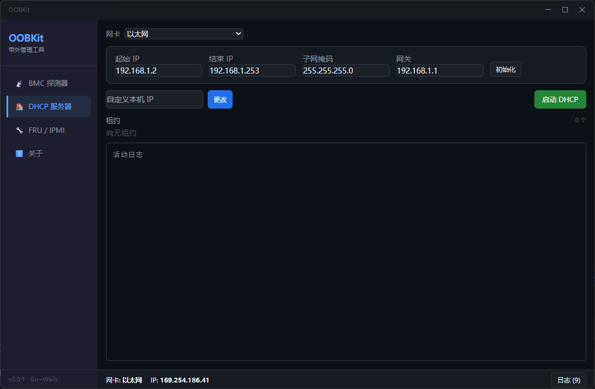
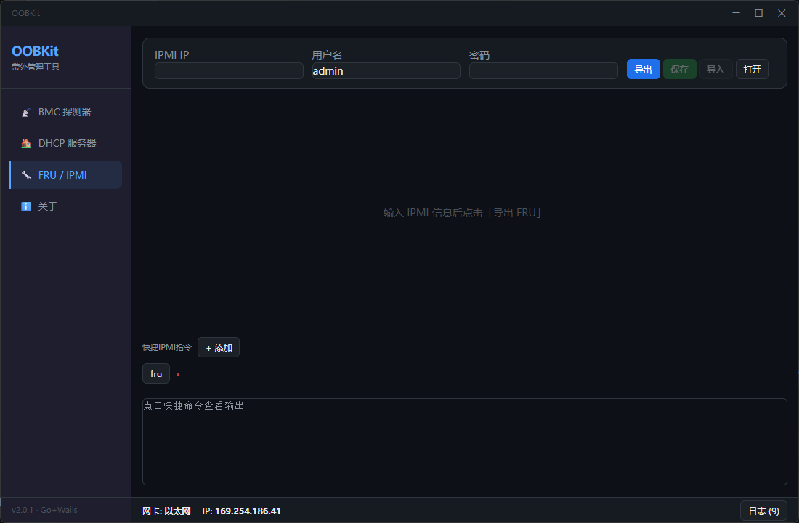

# OOBKit — 带外管理工具

> BMC 探测发现 · DHCP 服务器 · 网卡 VLAN · FRU 读写 · IPMI 快捷命令，一体化带外运维工具箱

基于 **Go + Wails v2 + Vue 3** 的 Windows 桌面应用。

## 功能

| 模块 | 说明 |
| ---- | ---- |
| BMC 探测器 | 跨网段扫描局域网内的 BMC，支持一键配网 |
| DHCP 服务器 | 内置轻量 DHCP 服务，给无 IP 的 BMC 分配地址，租约表格实时显示 |
| 网卡 VLAN | 读取网卡驱动的 VLAN 高级属性（或注册表 VlanID），设置/清除 802.1Q 标签，可选应用后重启网卡 |
| FRU / IPMI | FRU 信息导出/导入/保存，支持 IPMI 命令快捷执行（sel、mc、chassis、lan、fru、sensor 等 30+ 命令别名，以及 raw 十六进制） |
| 关于 | 版本信息与作者信息 |

## 截图

| BMC 探测器 | DHCP 服务器 | FRU / IPMI |
| ---------- | ----------- | ---------- |
|  |  |  |

## 构建（Windows）

### 前置条件

1. [Go 1.22+](https://go.dev/dl/)
2. [Wails CLI](https://wails.io/docs/gettingstarted/installation)：

   ```bash
   go install github.com/wailsapp/wails/v2/cmd/wails@latest
   ```

3. 无需 CGO/GCC：gopacket 的 pcap 在 Windows 上通过 `syscall` 动态加载 `wpcap.dll`，
   `CGO_ENABLED=0` 即可编译（抓包仍需用户安装 Npcap）。

### 编译

```bash
go mod tidy
$env:CGO_ENABLED='0'
wails build -platform windows/amd64
```

产物在 `build/bin/OOBKit.exe`。

### 开发调试

```bash
wails dev
```

## 运行依赖

- **Npcap**（抓包驱动，BMC 探测功能必需）：程序检测到未安装时会自动引导打开 [npcap.com](https://npcap.com/) 官网，请自行下载安装。
  - Npcap 个人使用免费，商业用途需向 Nmap 项目购买许可。本工具不随附、不分发 Npcap。

## 技术栈

| 层 | 技术 |
| ---- | ---- |
| 桌面框架 | Wails v2 |
| 后端 | Go + gopacket + go-ipmi |
| 前端 | Vue 3 + 原生 HTML/CSS |
| 抓包 | gopacket/pcap（调用 Npcap） |
| IP 配置 | Windows netsh / PowerShell |
| IPMI | github.com/bougou/go-ipmi |
| DHCP | github.com/krolaw/dhcp4 |

## 项目结构

```
.
├── main.go                  # Wails 入口（UAC 提权 + 无边框窗口）
├── app.go                   # 后端 API（探测/配网/DHCP/Npcap 检测）
├── fru.go                   # FRU 读写 + IPMI 命令执行
├── dhcp.go                  # DHCP 服务器
├── vlan.go                  # 网卡 VLAN ID（驱动高级属性 / 注册表）
├── dhcp_conn_windows.go     # DHCP UDP socket（Windows）
├── exec_hide_windows.go     # 隐藏 shell 命令窗口（Windows）
├── build/
│   └── appicon.png          # 应用图标
├── frontend/
│   └── dist/
│       └── index.html       # Vue 3 单文件前端
└── wails.json               # Wails 配置
```

## 免责声明

本工具涉及修改网卡 IP、写 FRU、控制 BMC 等操作，请仅在你拥有管理权限的设备上使用。作者不对因使用本工具造成的任何损失负责。

## 贡献者

感谢以下贡献者：

- [cxrmy](https://github.com/cxrmy) — 项目作者
- [Izgenlre](https://github.com/Izgenlre) — mDNS/DHCP/LLDP 被动识别

## 更新日志

版本变更记录见 [CHANGELOG.md](CHANGELOG.md)。

## 许可证

本项目采用 [GNU General Public License v3](LICENSE) 开源协议。

- 可自由使用、修改、分发
- 衍生作品必须以相同协议开源
- 不提供任何担保
